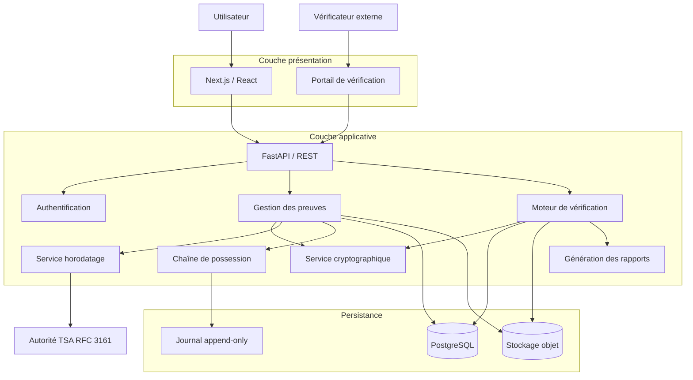
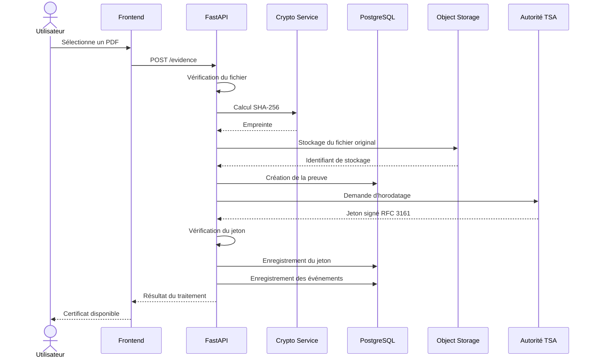
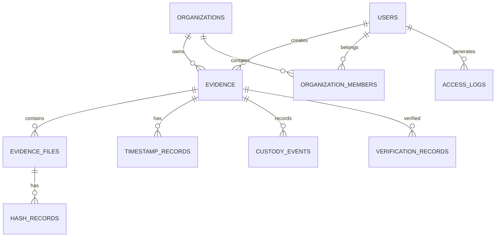
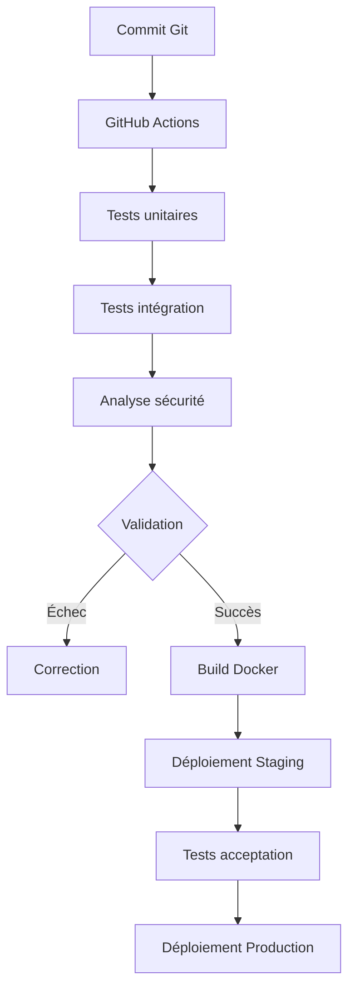

Parfait. Nous passons maintenant de la vision fonctionnelle à la conception technique de VERITAS.

Je vais créer le Technical Design Document (TDD) – Version 1.0. C'est le document qui servira de référence avant l'écriture du code.

Cette fois, nous allons entrer dans les détails de l'ingénierie logicielle :

* Architecture technique et interactions entre composants.

* Diagrammes UML et flux de traitement.

* Modèle relationnel PostgreSQL.

* Contrats des API REST.

* Algorithmes cryptographiques.

* Chaîne de possession des preuves.

* Sécurité, contrôle d'accès et gestion des clés.

* Tests techniques et stratégie de déploiement.

Une décision importante : nous allons conserver une architecture simple, mais concevoir les mécanismes de preuve avec une rigueur suffisante pour qu'ils puissent évoluer vers une plateforme professionnelle.

# VERITAS
# TECHNICAL DESIGN DOCUMENT (TDD)

**Document :** Spécifications de conception technique
**Version :** 1.0
**Date :** 11 novembre 2026
**Statut :** Conception initiale
**Architecture :** Monolithe modulaire
**Stack principale :** Next.js, FastAPI, Python, PostgreSQL, Docker
**Équipe initiale :** Une développeuse de niveau intermédiaire

---

# 1. INTRODUCTION

## 1.1. Objet du document

Ce document définit l'architecture technique de VERITAS et décrit les mécanismes nécessaires à son implémentation.

Il complète le cahier des charges fonctionnel et constitue la référence technique pour le développement du MVP.

Il précise notamment :

- Les composants logiciels.
- Les responsabilités de chaque module.
- Les interactions entre les composants.
- Les structures de données.
- Les interfaces de programmation.
- Les mécanismes cryptographiques.
- Les exigences de sécurité.
- Les stratégies de validation et de déploiement.

## 1.2. Objectif technique

Construire une application web permettant de créer un dossier de preuve numérique comprenant :

1. Un fichier original.
2. Une empreinte cryptographique.
3. Un jeton d'horodatage signé.
4. Un historique des événements.
5. Un manifeste de preuve.
6. Un mécanisme de vérification indépendant.

## 1.3. Principes de conception

L'architecture reposera sur les principes suivants :

| Principe | Application |
|---|---|
| Simplicité | Monolithe modulaire |
| Séparation des responsabilités | Modules indépendants |
| Sécurité | Security by Design |
| Intégrité | Empreintes cryptographiques |
| Traçabilité | Journal append-only |
| Interopérabilité | API REST et formats ouverts |
| Évolutivité | Modules remplaçables |
| Vérifiabilité | Validation indépendante |

---

# 2. ARCHITECTURE GÉNÉRALE

## 2.1. Architecture logique

VERITAS sera organisé en quatre couches principales :

- Couche présentation.
- Couche applicative.
- Couche métier.
- Couche infrastructure et persistance.

### Diagramme d'architecture



## 2.2. Choix architectural : monolithe modulaire

Le backend sera une application FastAPI unique.

Chaque module possédera une responsabilité clairement définie.

Les modules communiqueront initialement par des appels internes Python.

Cette approche permettra :

- Un déploiement simplifié.
- Un débogage plus facile.
- Une maintenance moins coûteuse.
- Une meilleure maîtrise de la complexité.
- Une éventuelle extraction de modules en services indépendants à long terme.

Il ne sera pas nécessaire de mettre en place une architecture microservices pour le MVP.

## 2.3. Technologies retenues

| Technologie | Responsabilité |
|---|---|
| Next.js | Interface utilisateur |
| TypeScript | Typage frontend |
| Python | Logique métier |
| FastAPI | API backend |
| PostgreSQL | Métadonnées et événements |
| SQLAlchemy | Accès aux données |
| Alembic | Migrations |
| cryptography | Opérations cryptographiques |
| Pytest | Tests automatisés |
| Docker | Conteneurisation |
| Docker Compose | Environnement local |
| S3 compatible | Stockage des fichiers |

Les versions exactes seront figées dans les fichiers de dépendances au démarrage du développement.

---

# 3. STRUCTURE DU PROJET

## 3.1. Organisation des répertoires

```text
veritas/
│
├── frontend/
│   ├── app/
│   │   ├── login/
│   │   ├── dashboard/
│   │   ├── evidence/
│   │   └── verify/
│   │
│   ├── components/
│   ├── hooks/
│   ├── services/
│   ├── types/
│   └── package.json
│
├── backend/
│   ├── app/
│   │   ├── main.py
│   │   │
│   │   ├── api/
│   │   │   └── v1/
│   │   │
│   │   ├── core/
│   │   │   ├── config.py
│   │   │   ├── security.py
│   │   │   └── exceptions.py
│   │   │
│   │   ├── auth/
│   │   ├── users/
│   │   ├── evidence/
│   │   ├── crypto/
│   │   ├── timestamp/
│   │   ├── custody/
│   │   ├── verification/
│   │   ├── reports/
│   │   ├── storage/
│   │   ├── database/
│   │   └── schemas/
│   │
│   ├── migrations/
│   ├── tests/
│   ├── requirements.txt
│   └── Dockerfile
│
├── infrastructure/
│   ├── docker/
│   └── scripts/
│
├── documentation/
│
├── docker-compose.yml
├── .env.example
└── README.md
```

## 3.2. Responsabilités des modules backend

| Module | Responsabilité |
|---|---|
| auth | Authentification et sessions |
| users | Gestion des utilisateurs |
| evidence | Création et gestion des preuves |
| crypto | Calcul et vérification des empreintes |
| timestamp | Communication avec la TSA |
| custody | Gestion des événements |
| verification | Vérification indépendante |
| reports | Génération des dossiers |
| storage | Gestion des fichiers |
| database | Connexion et persistance |
| core | Configuration et sécurité transversale |

Les routes API ne devront pas contenir directement toute la logique métier. Elles appelleront des services dédiés.

---

# 4. FLUX TECHNIQUE DE CRÉATION D'UNE PREUVE

## 4.1. Description du processus

Lorsqu'un utilisateur dépose un fichier, le système exécute les opérations suivantes :

1. Vérifier l'identité et les permissions de l'utilisateur.
2. Contrôler le fichier reçu.
3. Placer le fichier en zone de quarantaine si nécessaire.
4. Vérifier son type et ses caractéristiques.
5. Calculer son empreinte SHA-256.
6. Enregistrer le fichier original dans le stockage objet.
7. Créer l'enregistrement de preuve.
8. Envoyer l'empreinte à l'autorité d'horodatage.
9. Vérifier le jeton retourné.
10. Enregistrer les événements de traçabilité.
11. Construire le manifeste de preuve.
12. Générer le rapport téléchargeable.

Le traitement devra être transactionnel autant que possible. Les opérations externes, notamment l'horodatage, seront gérées avec des états explicites et une stratégie de reprise.

## 4.2. Diagramme de séquence



## 4.3. États d'une preuve

Une preuve pourra avoir les états suivants :

| État | Signification |
|---|---|
| RECEIVED | Fichier reçu |
| PROCESSING | Traitement en cours |
| HASHED | Empreinte calculée |
| TIMESTAMP_PENDING | Horodatage demandé |
| CERTIFIED | Horodatage validé et dossier constitué |
| FAILED | Échec du traitement |
| ARCHIVED | Preuve archivée |

L'état CERTIFIED ne pourra être attribué que lorsque les conditions de validation définies seront satisfaites.

Une erreur temporaire du fournisseur TSA ne devra pas entraîner la perte du fichier ou de son empreinte.

---

# 5. CONCEPTION DU MOTEUR CRYPTOGRAPHIQUE

## 5.1. Calcul SHA-256

Le système utilisera SHA-256 pour calculer l'empreinte des fichiers.

Le calcul devra être effectué en flux (streaming) afin de limiter la consommation mémoire.

Exemple Python :

```python
import hashlib

def calculate_sha256(file_path: str) -> str:
    digest = hashlib.sha256()

    with open(file_path, "rb") as file:
        while chunk := file.read(1024 * 1024):
            digest.update(chunk)

    return digest.hexdigest()
```

Cette fonction est illustrative. En production, le traitement devra également gérer les erreurs de lecture, les fichiers temporaires et les limites de taille.

## 5.2. Modèle d'empreinte

Chaque empreinte devra être associée à :

- Un identifiant de preuve.
- Un algorithme.
- Une valeur hexadécimale.
- Une date de calcul.
- Une version du moteur cryptographique.

Exemple :

```json
{
  "algorithm": "SHA-256",
  "digest": "9f86d081884c7d659a2feaa0c55ad015...",
  "encoding": "hex",
  "version": "1.0"
}
```

L'algorithme devra être enregistré explicitement afin de permettre une évolution cryptographique ultérieure.

## 5.3. Gestion des empreintes multiples

Une preuve pourra posséder plusieurs empreintes au cours de son cycle de vie.

Par exemple :

- SHA-256 pour le MVP.
- SHA-512 comme extension éventuelle.
- Autres algorithmes approuvés selon les besoins futurs.

Une nouvelle empreinte ne devra jamais écraser silencieusement une empreinte historique.

---

# 6. CONCEPTION DU SERVICE D'HORODATAGE

## 6.1. Principe RFC 3161

VERITAS utilisera un fournisseur d'horodatage externe conforme à RFC 3161.

L'application ne devra pas prétendre être elle-même une autorité de temps indépendante sans infrastructure et procédures adaptées.

## 6.2. Processus

1. Calculer le message imprint du document.
2. Construire une demande TimeStampReq.
3. Transmettre la demande à la TSA.
4. Recevoir un TimeStampResp.
5. Vérifier le statut de la réponse.
6. Vérifier la correspondance du message imprint.
7. Valider la signature du jeton.
8. Vérifier les certificats et les informations de révocation pertinentes.
9. Conserver le jeton original.

La validation devra également contrôler les champs pertinents, notamment le nonce lorsqu'il est utilisé, le policy OID et l'identité de la TSA.

## 6.3. Architecture logicielle

Le module timestamp devra utiliser une interface abstraite :

```python
class TimestampProvider:

    def create_timestamp(self, digest: bytes):
        raise NotImplementedError

    def verify_timestamp(self, token: bytes, digest: bytes):
        raise NotImplementedError
```

Un adaptateur concret communiquera avec le fournisseur TSA choisi.

Cette abstraction permettra de remplacer un fournisseur sans modifier toute l'application.

## 6.4. Gestion des erreurs

Les situations suivantes devront être prises en charge :

- TSA indisponible.
- Timeout.
- Réponse invalide.
- Signature incorrecte.
- Empreinte non correspondante.
- Certificat expiré ou révoqué.
- Erreur réseau.

Une réponse non vérifiable ne devra jamais être présentée comme une certification réussie.

---

# 7. CONCEPTION DE LA CHAÎNE DE POSSESSION

## 7.1. Objectif

Construire un historique des opérations permettant de détecter toute modification ou suppression non autorisée d'un événement.

## 7.2. Structure d'un événement

Chaque événement devra contenir :

```json
{
  "event_id": "uuid",
  "evidence_id": "uuid",
  "event_type": "FILE_UPLOADED",
  "actor_id": "uuid",
  "timestamp_utc": "2026-11-11T20:00:00Z",
  "sequence_number": 1,
  "previous_event_hash": null,
  "event_hash": "sha256-value",
  "metadata": {
    "action": "upload"
  }
}
```

## 7.3. Chaînage cryptographique

Chaque événement sera associé à l'empreinte de l'événement précédent.

Formule conceptuelle :

\[
H_n = SHA256(H_{n-1} \parallel C(E_n))
\]

Où :

- \(H_n\) représente l'empreinte de l'événement courant.
- \(H_{n-1}\) représente l'empreinte précédente.
- \(C(E_n)\) représente la représentation canonique de l'événement.
- \(\parallel\) représente la concaténation.

La représentation canonique devra être déterministe. Il ne faudra pas calculer l'empreinte directement sur une sérialisation JSON arbitraire.

On pourra utiliser JSON Canonicalization Scheme (RFC 8785) ou une représentation binaire canonique documentée.

## 7.4. Protection supplémentaire

Le chaînage seul n'empêche pas un administrateur ayant un contrôle complet sur la base de données de reconstruire un historique.

Pour renforcer la confiance, les évolutions devront inclure :

- Restrictions d'écriture et séparation des privilèges.
- Stockage avec rétention immuable.
- Ancrage périodique des empreintes dans un service externe.
- Horodatage des empreintes de lots d'événements.
- Sauvegardes protégées.

Le système devra distinguer les événements métier des journaux de sécurité de l'infrastructure.

---

# 8. MODÈLE DE DONNÉES POSTGRESQL

## 8.1. Entités principales

Le modèle initial comprendra les tables suivantes :

1. users
2. organizations
3. organization_members
4. evidence
5. evidence_files
6. hash_records
7. timestamp_records
8. custody_events
9. verification_records
10. access_logs

## 8.2. Relations



## 8.3. Structure indicative des tables

### Table users

| Champ | Type | Description |
|---|---|---|
| id | UUID | Identifiant |
| email | VARCHAR | Adresse électronique |
| password_hash | VARCHAR | Hash du mot de passe |
| created_at | TIMESTAMPTZ | Création |
| is_active | BOOLEAN | État du compte |

### Table evidence

| Champ | Type | Description |
|---|---|---|
| id | UUID | Identifiant |
| owner_id | UUID | Propriétaire |
| organization_id | UUID nullable | Organisation |
| title | VARCHAR | Nom |
| status | VARCHAR | État |
| created_at | TIMESTAMPTZ | Date de réception |
| certified_at | TIMESTAMPTZ nullable | Date de certification |

### Table evidence_files

| Champ | Type | Description |
|---|---|---|
| id | UUID | Identifiant |
| evidence_id | UUID | Preuve associée |
| original_filename | VARCHAR | Nom original |
| storage_key | VARCHAR | Référence de stockage |
| file_size | BIGINT | Taille |
| media_type | VARCHAR | Type déclaré et validé |
| created_at | TIMESTAMPTZ | Réception |

### Table hash_records

| Champ | Type | Description |
|---|---|---|
| id | UUID | Identifiant |
| file_id | UUID | Fichier |
| algorithm | VARCHAR | Algorithme |
| digest | VARCHAR | Empreinte |
| calculated_at | TIMESTAMPTZ | Calcul |

### Table timestamp_records

| Champ | Type | Description |
|---|---|---|
| id | UUID | Identifiant |
| evidence_id | UUID | Preuve |
| hash_record_id | UUID | Empreinte horodatée |
| tsa_name | VARCHAR | Fournisseur |
| token_storage_key | VARCHAR | Emplacement du jeton |
| generation_time | TIMESTAMPTZ | Temps attesté |
| validation_status | VARCHAR | Résultat |
| created_at | TIMESTAMPTZ | Enregistrement |

### Table custody_events

| Champ | Type | Description |
|---|---|---|
| id | UUID | Identifiant |
| evidence_id | UUID | Preuve |
| actor_id | UUID nullable | Acteur |
| event_type | VARCHAR | Opération |
| sequence_number | BIGINT | Ordre |
| event_data | JSONB | Données |
| previous_event_hash | VARCHAR nullable | Empreinte précédente |
| event_hash | VARCHAR | Empreinte courante |
| created_at | TIMESTAMPTZ | Date serveur |

## 8.4. Contraintes importantes

- Les identifiants seront des UUID.
- Les relations seront protégées par des clés étrangères.
- Les empreintes seront indexées.
- Les événements auront une contrainte d'unicité sur la séquence par preuve.
- Les suppressions en cascade seront évitées pour les dossiers de preuve certifiés.
- Les données sensibles ne seront pas dupliquées inutilement.
- Les événements certifiés ne seront pas modifiés par des opérations CRUD ordinaires.

---

# 9. CONTRATS DES API REST

## 9.1. Principes

L'API sera versionnée.

Préfixe :

`/api/v1`

Les échanges utiliseront JSON, sauf pour les transferts de fichiers.

Les erreurs devront utiliser des codes HTTP cohérents et des messages normalisés.

## 9.2. Authentification

| Méthode | Endpoint | Description |
|---|---|---|
| POST | /auth/register | Inscription |
| POST | /auth/login | Connexion |
| POST | /auth/logout | Déconnexion |
| POST | /auth/refresh | Renouvellement |
| GET | /auth/me | Profil courant |

Le mécanisme d'authentification sera choisi en tenant compte de la protection contre le vol de session, du CSRF et du stockage des jetons.

## 9.3. Gestion des preuves

| Méthode | Endpoint | Description |
|---|---|---|
| POST | /evidence | Créer une preuve |
| GET | /evidence | Lister les preuves |
| GET | /evidence/{id} | Consulter |
| GET | /evidence/{id}/events | Historique |
| GET | /evidence/{id}/manifest | Manifeste |
| GET | /evidence/{id}/report | Rapport |

## 9.4. Vérification

| Méthode | Endpoint | Description |
|---|---|---|
| POST | /verify | Vérifier un dossier |
| GET | /verify/{id} | Consulter le résultat |
| GET | /verify/{id}/report | Télécharger le rapport |

L'API de vérification publique ne devra pas permettre de récupérer des documents privés ou des informations personnelles simplement à partir d'un identifiant.

## 9.5. Exemple de création d'une preuve

Requête :

```http
POST /api/v1/evidence
Authorization: Bearer <token>
Content-Type: multipart/form-data
```

Réponse indicative :

```json
{
  "evidence_id": "550e8400-e29b-41d4-a716-446655440000",
  "status": "TIMESTAMP_PENDING",
  "filename": "contrat.pdf",
  "hash_algorithm": "SHA-256",
  "digest": "9f86d081884c7d659a2feaa0c55ad015...",
  "created_at": "2026-11-11T20:00:00Z"
}
```

L'identifiant sera généré par le serveur. Le statut pourra évoluer après la réponse initiale.

---

# 10. FORMAT DU DOSSIER DE PREUVE

## 10.1. Structure proposée

Le dossier exporté devra être autonome et structuré.

```text
VERITAS-EVIDENCE-001/
│
├── manifest.json
├── original/
│   └── document.pdf
│
├── cryptographic/
│   ├── hash-record.json
│   └── timestamp-token.tsr
│
├── custody/
│   └── events.json
│
├── certificates/
│   └── tsa-certificates/
│
├── validation/
│   └── validation-report.json
│
└── report.pdf
```

## 10.2. Manifeste

Le manifeste sera le document central du dossier.

Il décrira :

- L'identifiant de la preuve.
- Les fichiers concernés.
- Les empreintes.
- Les algorithmes.
- Les jetons d'horodatage.
- Les événements.
- Les versions des outils.
- Les informations nécessaires à la vérification.

Le manifeste devra posséder une structure versionnée.

Son propre contenu sera également protégé par une empreinte cryptographique.

Pour éviter toute ambiguïté circulaire, le calcul de l'empreinte du manifeste exclura son champ de checksum ou utilisera une procédure de calcul explicitement définie.

---

# 11. MOTEUR DE VÉRIFICATION INDÉPENDANTE

## 11.1. Objectif

Permettre à un tiers de vérifier le dossier sans faire confiance au résultat simplement affiché par le serveur VERITAS.

## 11.2. Opérations

Le moteur devra :

1. Lire le manifeste.
2. Vérifier son format et sa version.
3. Recalculer l'empreinte du fichier original.
4. Comparer l'empreinte calculée à celle du manifeste.
5. Vérifier la structure du jeton RFC 3161.
6. Vérifier la signature du jeton.
7. Contrôler la chaîne de certificats.
8. Contrôler les informations de révocation disponibles.
9. Vérifier les événements et leur chaînage.
10. Produire un rapport détaillé.

## 11.3. Résultats

Les résultats seront séparés :

| Contrôle | Résultat possible |
|---|---|
| Intégrité du fichier | PASS / FAIL |
| Jeton d'horodatage | PASS / FAIL / UNKNOWN |
| Chaîne de certificats | PASS / FAIL / UNKNOWN |
| Chaîne de possession | PASS / FAIL |
| Complétude du dossier | COMPLETE / INCOMPLETE |

Un résultat UNKNOWN devra être utilisé lorsque les informations nécessaires à une conclusion fiable ne sont pas disponibles.

Une vérification réussie de l'intégrité ne devra jamais être présentée comme une preuve automatique de véracité du contenu.

## 11.4. Vérification hors ligne

À terme, le moteur de vérification pourra être distribué sous forme d'un outil autonome.

Il devra utiliser les éléments du dossier et les certificats de confiance appropriés.

Cette fonctionnalité est essentielle pour réduire la dépendance à l'infrastructure VERITAS.

---

# 12. SÉCURITÉ ET MODÈLE DE MENACES

## 12.1. Actifs à protéger

- Documents originaux.
- Empreintes cryptographiques.
- Jetons d'horodatage.
- Historique des événements.
- Comptes utilisateurs.
- Clés cryptographiques.
- Informations personnelles.
- Certificats de preuve.

## 12.2. Menaces principales

| Menace | Protection |
|---|---|
| Modification d'un fichier | SHA-256 |
| Remplacement d'un fichier stocké | Vérification de l'empreinte |
| Modification de l'historique | Chaînage et ancrage externe |
| Accès non autorisé | Authentification et autorisation |
| Vol de session | Protection des sessions |
| Fichier malveillant | Quarantaine et analyse |
| Compromission d'un compte admin | MFA et séparation des rôles |
| Falsification d'un horodatage | Validation du jeton TSA |
| Fuite de données | Chiffrement et contrôles d'accès |
| Suppression malveillante | Rétention immuable et sauvegardes |

## 12.3. Gestion des clés

Les clés privées ne devront pas être stockées en clair dans le dépôt de code ou dans la base de données.

Les secrets de production devront être gérés par un gestionnaire de secrets.

Pour le MVP, VERITAS s'appuiera sur la clé de signature de la TSA pour les jetons d'horodatage. Il n'est donc pas nécessaire de créer sa propre autorité d'horodatage.

## 12.4. Protection des fichiers

Les fichiers seront :

- Contrôlés avant traitement.
- Stockés dans un espace privé.
- Chiffrés au repos.
- Accessibles par des permissions limitées.
- Téléchargés au moyen d'accès temporaires.
- Vérifiés à nouveau avant toute opération critique.

Les fichiers devront être servis en téléchargement sécurisé, sans interprétation active dans le navigateur.

---

# 13. STRATÉGIE DE TESTS

## 13.1. Tests unitaires

Chaque module devra posséder ses propres tests.

Exemples :

- Calcul SHA-256.
- Vérification des empreintes.
- Canonicalisation des événements.
- Calcul de la chaîne de hachage.
- Validation des métadonnées.
- Gestion des états.

## 13.2. Tests d'intégration

Tester les interactions :

- API et PostgreSQL.
- API et stockage objet.
- Backend et TSA.
- Backend et moteur de vérification.

## 13.3. Tests de sécurité

- Tentatives d'accès entre utilisateurs.
- Téléversement de fichiers malveillants.
- Manipulation des identifiants.
- Altération des événements.
- Vol et réutilisation de jetons.
- Accès direct aux fichiers privés.
- Attaques courantes OWASP.

## 13.4. Tests de non-régression

Chaque modification du code devra être accompagnée de tests garantissant que les mécanismes cryptographiques et les processus de certification continuent de fonctionner.

## 13.5. Tests d'acceptation

Le scénario de référence sera :

Un utilisateur dépose un PDF, obtient un dossier de preuve, modifie une copie du PDF, puis soumet les deux versions au moteur de vérification.

Résultat attendu :

- Le document original est reconnu comme correspondant à l'empreinte enregistrée.
- Le document modifié est rejeté.
- Le jeton d'horodatage est vérifié indépendamment.
- L'historique présente une chaîne cohérente.

---

# 14. DÉPLOIEMENT ET INFRASTRUCTURE

## 14.1. Environnement de développement

L'environnement initial utilisera Docker Compose.

Services :

- Frontend.
- Backend.
- PostgreSQL.
- Stockage objet compatible S3, en local si nécessaire.

## 14.2. Environnements

Trois environnements seront prévus :

| Environnement | Usage |
|---|---|
| Development | Développement local |
| Staging | Validation avant production |
| Production | Utilisation réelle |

Les secrets et les données devront être séparés entre les environnements.

## 14.3. Pipeline CI/CD



Le déploiement en production devra inclure une validation des migrations de base de données, une stratégie de retour arrière et une vérification des sauvegardes.

---

# 15. DÉCISIONS ARCHITECTURALES

Les décisions suivantes sont retenues pour le MVP.

| ID | Décision | Justification |
|---|---|---|
| ADR-001 | Monolithe modulaire | Réduction de la complexité |
| ADR-002 | FastAPI | Simplicité et productivité Python |
| ADR-003 | PostgreSQL | Persistance relationnelle fiable |
| ADR-004 | SHA-256 | Empreinte largement supportée |
| ADR-005 | RFC 3161 | Horodatage standardisé |
| ADR-006 | Stockage objet privé | Séparation fichiers et métadonnées |
| ADR-007 | Journal chaîné | Détection des altérations |
| ADR-008 | API REST | Interopérabilité |
| ADR-009 | Vérification autonome | Réduction de la dépendance fournisseur |
| ADR-010 | Docker Compose | Simplicité opérationnelle |

Ces décisions pourront évoluer si les exigences de sécurité, de performance ou de conformité l'imposent.

---

# 16. PLAN TECHNIQUE D'IMPLÉMENTATION

Le développement sera exécuté dans l'ordre suivant.

## Phase 1 : Fondations

- Créer le dépôt Git.
- Initialiser Next.js.
- Initialiser FastAPI.
- Configurer Docker Compose.
- Configurer PostgreSQL.
- Mettre en place SQLAlchemy et Alembic.

**Livrable :** application initialisée et exécutable localement.

## Phase 2 : Authentification et gestion des utilisateurs

- Création de comptes.
- Connexion.
- Gestion des sessions.
- Protection des routes.
- Contrôle des permissions.

**Livrable :** environnement utilisateur sécurisé.

## Phase 3 : Gestion des preuves

- Interface de téléversement.
- Validation des fichiers.
- Stockage objet.
- Génération des identifiants.
- Création des enregistrements PostgreSQL.

**Livrable :** premier dépôt de fichier fonctionnel.

## Phase 4 : Cryptographie

- Calcul SHA-256.
- Enregistrement des empreintes.
- Tests d'intégrité.
- Détection des modifications.

**Livrable :** moteur cryptographique fonctionnel.

## Phase 5 : Horodatage

- Intégration TSA.
- Création des requêtes RFC 3161.
- Vérification des jetons.
- Conservation des certificats nécessaires.

**Livrable :** première preuve horodatée.

## Phase 6 : Chaîne de possession

- Modèle des événements.
- Canonicalisation.
- Chaînage cryptographique.
- Vérification des séquences.

**Livrable :** historique vérifiable.

## Phase 7 : Génération des dossiers

- Manifeste JSON.
- Export des jetons.
- Génération du rapport PDF.
- Packaging du dossier.

**Livrable :** dossier de preuve exportable.

## Phase 8 : Vérification indépendante

- Téléversement du dossier.
- Recalcul des empreintes.
- Validation cryptographique.
- Rapport de vérification.

**Livrable :** portail de vérification fonctionnel.

## Phase 9 : Sécurisation et pilote

- Tests complets.
- Analyse des vulnérabilités.
- Vérification des sauvegardes.
- Déploiement staging.
- Validation finale.

**Livrable :** MVP prêt pour un pilote contrôlé.

---

# 17. LIVRABLES TECHNIQUES ATTENDUS

À la fin du MVP, le dépôt devra contenir :

1. Le code source frontend.
2. Le code source backend.
3. Le schéma de base de données.
4. Les migrations Alembic.
5. Les tests automatisés.
6. La configuration Docker.
7. La documentation API.
8. Le mécanisme cryptographique.
9. L'intégration TSA.
10. Le moteur de vérification.
11. Le format de dossier de preuve.
12. La documentation d'installation.
13. La documentation de sécurité.
14. Les procédures de sauvegarde et de restauration.

---

# 18. CRITÈRE FINAL DE VALIDATION TECHNIQUE

Le MVP sera techniquement acceptable lorsque le test suivant sera réussi :

**Une personne A dépose un document sur VERITAS. La plateforme produit une empreinte, obtient un jeton d'horodatage signé, enregistre les événements et génère un dossier de preuve.**

**Une personne B, qui ne fait pas nécessairement confiance à VERITAS, récupère le dossier et utilise un mécanisme de vérification indépendant pour contrôler :**

- L'intégrité du document.
- La validité de l'horodatage.
- La cohérence de l'historique.
- L'intégrité du manifeste.

La vérification doit pouvoir être effectuée sans se fier aveuglément au résultat communiqué par le serveur ayant créé la preuve.

---

# 19. CONCLUSION TECHNIQUE

VERITAS sera développé comme une application modulaire reposant sur des standards cryptographiques documentés.

La priorité ne sera pas de multiplier les fonctionnalités, mais de construire un mécanisme fiable de création et de vérification de preuves numériques.

Le choix d'un monolithe modulaire permettra de maîtriser la complexité initiale et de conserver une architecture capable d'évoluer.

Le produit devra démontrer trois propriétés fondamentales :

1. **Intégrité :** détecter toute modification du contenu protégé.
2. **Traçabilité :** rendre les altérations de l'historique détectables.
3. **Vérifiabilité :** permettre à un tiers de contrôler les éléments de preuve indépendamment.

La réussite de cette première version constituera la fondation de l'ambition à long terme de VERITAS.

**VERITAS — Trust through verifiable evidence.**

### Ce que je te recommande de produire maintenant

Nous avons deux documents fondateurs :

* Document 1 : Cahier des charges fonctionnel.

* Document 2 : Technical Design Document.

La prochaine étape sera le Document 3 : Technical Implementation Blueprint.

Il contiendra les éléments directement exploitables pour programmer :

* Le schéma SQL complet avec les clés primaires et étrangères.

* Les diagrammes UML des classes et des séquences.

* Les spécifications détaillées de chaque endpoint.

* Le squelette réel du backend FastAPI.

* Le squelette du frontend Next.js.

* Les fichiers Docker et la configuration PostgreSQL.

* Le backlog des tâches techniques, dans l'ordre de réalisation.

Mon conseil : ne commençons pas encore à écrire des centaines de lignes de code. Finalisons d'abord les fondations techniques pour éviter de devoir reconstruire l'application quelques semaines plus tard.

Notre première cible sera un MVP réellement fonctionnel, testable et démontrable.
