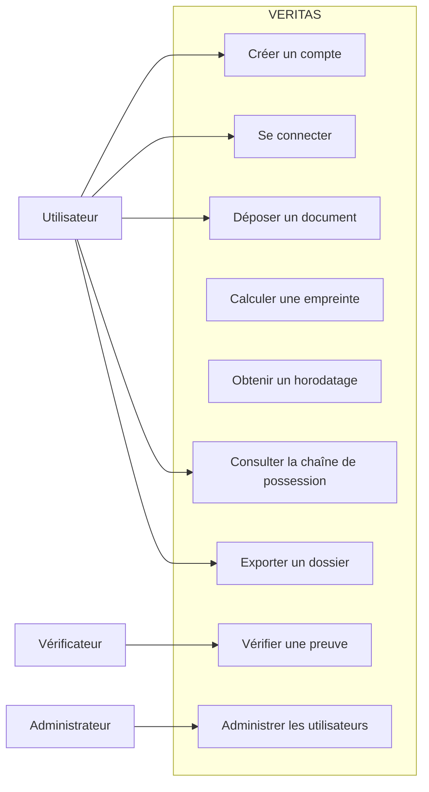
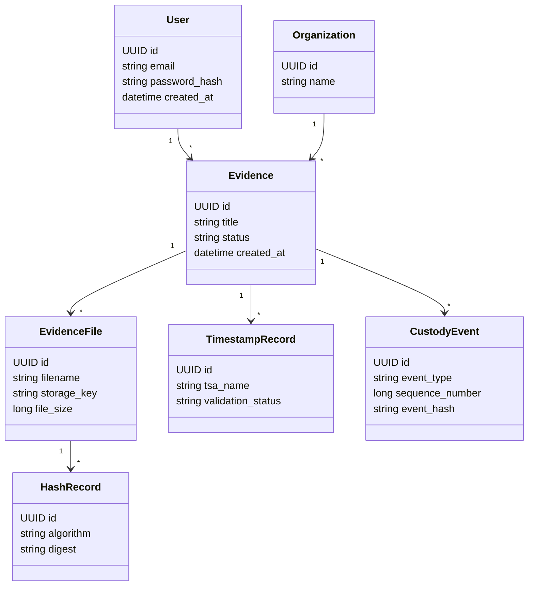
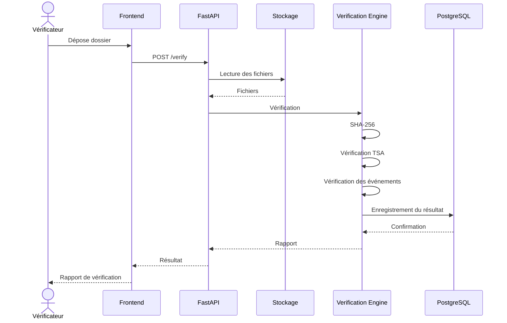

Très bien. Nous entrons maintenant dans la phase la plus concrète de VERITAS : le plan d'implémentation technique (Technical Implementation Blueprint).

Les deux premiers documents décrivent ce que nous voulons construire et comment l'architecture doit fonctionner. Le troisième va préciser comment passer de la conception au code, étape par étape.

Je vais également intégrer une règle importante : chaque composant devra être accompagné de critères de validation et de tests. Tu dois pouvoir développer seule, comprendre chaque décision et diagnostiquer les problèmes sans dépendre d'une autre développeuse.

### VERITAS — Document 3

TECHNICAL IMPLEMENTATION BLUEPRINT · VERSION 1.0

# VERITAS
# TECHNICAL IMPLEMENTATION BLUEPRINT

**Document :** Guide d'implémentation technique
**Version :** 1.0
**Date :** 11 novembre 2026
**Projet :** Plateforme universelle de preuve numérique
**Architecture :** Monolithe modulaire
**Développeuse :** Une développeuse de niveau intermédiaire
**Objectif :** Transformer les spécifications en application fonctionnelle.

---

# 1. OBJECTIF DU DOCUMENT

Ce document constitue le guide opérationnel de développement de VERITAS.

Il traduit les deux documents précédents en éléments directement exploitables :

- Schéma relationnel PostgreSQL.
- Diagrammes UML.
- Contrats détaillés des API.
- Structure du backend.
- Structure du frontend.
- Code initial des principaux composants.
- Configuration Docker.
- Stratégie de tests.
- Backlog technique.
- Ordre de développement.

## 1.1. Résultat attendu

À la fin de cette implémentation, nous devons disposer d'une application permettant :

1. De créer un compte.
2. De déposer un fichier PDF.
3. De calculer son empreinte SHA-256.
4. D'obtenir un horodatage RFC 3161.
5. De conserver un historique cryptographique.
6. De générer un dossier de preuve.
7. De permettre à un tiers de vérifier le dossier.

## 1.2. Périmètre technique initial

Nous ne développerons pas immédiatement :

- Une blockchain.
- Un réseau distribué.
- Une intelligence artificielle de détection des deepfakes.
- Une infrastructure microservices.
- Une autorité d'horodatage propriétaire.

Ces fonctionnalités pourront être étudiées ultérieurement.

---

# 2. ARCHITECTURE DU DÉPÔT GIT

## 2.1. Initialisation

Nom du dépôt :

`veritas-platform`

Organisation :

```text
veritas-platform/
│
├── frontend/
│
├── backend/
│
├── infrastructure/
│   ├── docker/
│   └── scripts/
│
├── documentation/
│   ├── requirements/
│   ├── architecture/
│   ├── security/
│   └── api/
│
├── tests/
│
├── docker-compose.yml
├── .env.example
├── .gitignore
└── README.md
```

## 2.2. Convention de développement

Les conventions suivantes seront appliquées :

- Python : PEP 8.
- TypeScript : ESLint et Prettier.
- API : versionnement `/api/v1`.
- Base de données : migrations Alembic.
- Identifiants : UUID.
- Dates : UTC avec `TIMESTAMPTZ`.
- Code source : Git.
- Tests : Pytest et tests frontend adaptés.

Chaque fonctionnalité devra être développée dans une branche dédiée.

Exemples :

```text
main
develop
feature/authentication
feature/evidence-upload
feature/sha256-engine
feature/timestamp
feature/custody
feature/verification
```

---

# 3. SCHÉMA COMPLET DE LA BASE DE DONNÉES

La base de données constitue un élément central de VERITAS.

Nous utiliserons PostgreSQL.

## 3.1. Modèle relationnel

Les tables principales seront :

| Table | Fonction |
|---|---|
| users | Comptes utilisateurs |
| organizations | Organisations |
| organization_members | Appartenance aux organisations |
| evidence | Dossiers de preuve |
| evidence_files | Fichiers associés |
| hash_records | Empreintes cryptographiques |
| timestamp_records | Horodatages |
| custody_events | Chaîne de possession |
| verification_records | Vérifications |
| access_logs | Journalisation des accès |

## 3.2. Script SQL initial

Le script suivant constitue une première migration de référence.

```sql
CREATE EXTENSION IF NOT EXISTS pgcrypto;

CREATE TABLE users (
    id UUID PRIMARY KEY DEFAULT gen_random_uuid(),
    email VARCHAR(255) NOT NULL UNIQUE,
    password_hash VARCHAR(255) NOT NULL,
    is_active BOOLEAN NOT NULL DEFAULT TRUE,
    created_at TIMESTAMPTZ NOT NULL DEFAULT NOW()
);

CREATE TABLE organizations (
    id UUID PRIMARY KEY DEFAULT gen_random_uuid(),
    name VARCHAR(255) NOT NULL,
    created_at TIMESTAMPTZ NOT NULL DEFAULT NOW()
);

CREATE TABLE organization_members (
    id UUID PRIMARY KEY DEFAULT gen_random_uuid(),
    organization_id UUID NOT NULL
        REFERENCES organizations(id),
    user_id UUID NOT NULL REFERENCES users(id),
    role VARCHAR(30) NOT NULL,
    created_at TIMESTAMPTZ NOT NULL DEFAULT NOW(),
    UNIQUE (organization_id, user_id)
);

CREATE TABLE evidence (
    id UUID PRIMARY KEY DEFAULT gen_random_uuid(),
    owner_id UUID NOT NULL REFERENCES users(id),
    organization_id UUID REFERENCES organizations(id),
    title VARCHAR(255) NOT NULL,
    status VARCHAR(40) NOT NULL DEFAULT 'RECEIVED',
    created_at TIMESTAMPTZ NOT NULL DEFAULT NOW(),
    certified_at TIMESTAMPTZ
);

CREATE TABLE evidence_files (
    id UUID PRIMARY KEY DEFAULT gen_random_uuid(),
    evidence_id UUID NOT NULL REFERENCES evidence(id),
    original_filename VARCHAR(255) NOT NULL,
    storage_key VARCHAR(512) NOT NULL UNIQUE,
    media_type VARCHAR(100) NOT NULL,
    file_size BIGINT NOT NULL,
    created_at TIMESTAMPTZ NOT NULL DEFAULT NOW(),
    CHECK (file_size > 0)
);

CREATE TABLE hash_records (
    id UUID PRIMARY KEY DEFAULT gen_random_uuid(),
    file_id UUID NOT NULL REFERENCES evidence_files(id),
    algorithm VARCHAR(30) NOT NULL,
    digest VARCHAR(128) NOT NULL,
    calculated_at TIMESTAMPTZ NOT NULL DEFAULT NOW(),
    UNIQUE (file_id, algorithm, digest)
);

CREATE TABLE timestamp_records (
    id UUID PRIMARY KEY DEFAULT gen_random_uuid(),
    evidence_id UUID NOT NULL REFERENCES evidence(id),
    hash_record_id UUID NOT NULL REFERENCES hash_records(id),
    tsa_name VARCHAR(255) NOT NULL,
    token_storage_key VARCHAR(512) NOT NULL,
    generation_time TIMESTAMPTZ,
    validation_status VARCHAR(30) NOT NULL,
    created_at TIMESTAMPTZ NOT NULL DEFAULT NOW()
);

CREATE TABLE custody_events (
    id UUID PRIMARY KEY DEFAULT gen_random_uuid(),
    evidence_id UUID NOT NULL REFERENCES evidence(id),
    actor_id UUID REFERENCES users(id),
    event_type VARCHAR(80) NOT NULL,
    sequence_number BIGINT NOT NULL,
    event_data JSONB NOT NULL DEFAULT '{}',
    previous_event_hash VARCHAR(64),
    event_hash VARCHAR(64) NOT NULL,
    created_at TIMESTAMPTZ NOT NULL DEFAULT NOW(),
    UNIQUE (evidence_id, sequence_number)
);

CREATE TABLE verification_records (
    id UUID PRIMARY KEY DEFAULT gen_random_uuid(),
    evidence_id UUID REFERENCES evidence(id),
    verifier_id UUID REFERENCES users(id),
    integrity_status VARCHAR(30) NOT NULL,
    timestamp_status VARCHAR(30) NOT NULL,
    custody_status VARCHAR(30) NOT NULL,
    result JSONB NOT NULL,
    created_at TIMESTAMPTZ NOT NULL DEFAULT NOW()
);

CREATE TABLE access_logs (
    id UUID PRIMARY KEY DEFAULT gen_random_uuid(),
    user_id UUID REFERENCES users(id),
    action VARCHAR(100) NOT NULL,
    resource_type VARCHAR(100),
    resource_id UUID,
    created_at TIMESTAMPTZ NOT NULL DEFAULT NOW()
);

CREATE INDEX idx_evidence_owner
ON evidence(owner_id);

CREATE INDEX idx_evidence_status
ON evidence(status);

CREATE INDEX idx_custody_evidence_sequence
ON custody_events(evidence_id, sequence_number);

CREATE INDEX idx_hash_digest
ON hash_records(digest);

CREATE INDEX idx_timestamp_evidence
ON timestamp_records(evidence_id);
```

## 3.3. Règles d'intégrité

Quelques règles supplémentaires devront être implémentées au niveau applicatif et de la base de données :

- Un utilisateur ne peut consulter que les preuves auxquelles il a accès.
- Une preuve certifiée ne peut pas être supprimée par une opération ordinaire.
- Les événements ne peuvent pas être modifiés par les routes API ordinaires.
- Chaque nouvelle opération de traçabilité doit respecter l'ordre séquentiel.
- Les empreintes originales doivent être conservées.
- Les événements critiques doivent faire l'objet d'un ancrage externe périodique.

Une attention particulière sera accordée aux transactions concurrentes : deux événements simultanés ne doivent pas produire deux numéros de séquence identiques ou deux branches incohérentes.

---

# 4. DIAGRAMMES UML

## 4.1. Diagramme de cas d'utilisation



## 4.2. Diagramme de classes conceptuel



## 4.3. Diagramme de séquence de vérification



---

# 5. STRUCTURE DU BACKEND FASTAPI

## 5.1. Installation

Dans le répertoire backend :

```powershell
python -m venv .venv

.venv\Scripts\Activate.ps1

pip install fastapi uvicorn sqlalchemy
pip install psycopg[binary] alembic
pip install cryptography pydantic-settings
pip install python-multipart
pip install pytest httpx
```

Les versions des dépendances devront être figées dans le fichier de dépendances du projet.

## 5.2. Point d'entrée

Fichier : `backend/app/main.py`

```python
from fastapi import FastAPI

app = FastAPI(
    title="VERITAS API",
    description="Digital Evidence Verification Platform",
    version="1.0.0"
)

@app.get("/health")
def health_check():
    return {
        "status": "healthy",
        "application": "VERITAS"
    }
```

Démarrage :

```powershell
uvicorn app.main:app --reload
```

Documentation interactive :

`http://localhost:8000/docs`

## 5.3. Module cryptographique

Fichier : `backend/app/crypto/hash_service.py`

```python
import hashlib
from pathlib import Path

def calculate_sha256(file_path: str) -> str:

    digest = hashlib.sha256()

    with Path(file_path).open("rb") as file:

        while chunk := file.read(1024 * 1024):
            digest.update(chunk)

    return digest.hexdigest()

def verify_sha256(
    file_path: str,
    expected_digest: str
) -> bool:

    calculated = calculate_sha256(file_path)

    return calculated.lower() == expected_digest.lower()
```

Ce module devra être testé indépendamment du reste de l'application.

## 5.4. Module de gestion des preuves

Fichier : `backend/app/evidence/service.py`

```python
from app.crypto.hash_service import calculate_sha256

class EvidenceService:

    def __init__(self, repository, storage):
        self.repository = repository
        self.storage = storage

    def create_evidence(
        self,
        user_id,
        filename,
        temporary_path
    ):

        digest = calculate_sha256(temporary_path)

        storage_key = self.storage.save(
            temporary_path,
            filename
        )

        evidence = self.repository.create(
            owner_id=user_id,
            filename=filename,
            storage_key=storage_key,
            digest=digest
        )

        return evidence
```

Ce code illustre la séparation des responsabilités. En production, l'enregistrement, la gestion des fichiers temporaires et les opérations de stockage devront être orchestrés avec des états de traitement et des mécanismes de reprise.

## 5.5. Module de traçabilité

Fichier : `backend/app/custody/hash_chain.py`

```python
import hashlib
import json

def canonicalize_event(event: dict) -> bytes:

    serialized = json.dumps(
        event,
        sort_keys=True,
        separators=(",", ":"),
        ensure_ascii=False
    )

    return serialized.encode("utf-8")

def calculate_event_hash(
    previous_hash: str | None,
    event: dict
) -> str:

    previous = (
        bytes.fromhex(previous_hash)
        if previous_hash
        else b"\x00" * 32
    )

    payload = canonicalize_event(event)

    return hashlib.sha256(
        previous + payload
    ).hexdigest()
```

Pour la production, cette représentation devra être remplacée ou formellement encadrée par une sérialisation canonique standardisée, par exemple RFC 8785, avec une représentation documentée des données binaires, des dates et des nombres.

Les champs de l'événement devront être immuables une fois l'empreinte calculée.

## 5.6. Module d'horodatage

Fichier : `backend/app/timestamp/provider.py`

```python
from abc import ABC, abstractmethod

class TimestampProvider(ABC):

    @abstractmethod
    def create_timestamp(self, digest: bytes):
        pass

    @abstractmethod
    def verify_timestamp(
        self,
        token: bytes,
        digest: bytes
    ):
        pass
```

Cette interface permettra de connecter différents fournisseurs d'horodatage.

Une implémentation réelle devra construire et décoder les messages RFC 3161, vérifier les réponses signées et contrôler la chaîne de confiance.

Nous utiliserons un fournisseur TSA externe au lieu de construire notre propre autorité de certification.

---

# 6. STRUCTURE DU FRONTEND NEXT.JS

## 6.1. Initialisation

```powershell
npx create-next-app@latest frontend
```

Sélection recommandée :

- TypeScript : Yes.
- ESLint : Yes.
- Tailwind CSS : Yes.
- App Router : Yes.
- Source directory : Yes.

## 6.2. Structure

```text
frontend/
│
├── src/
│   ├── app/
│   │   ├── login/
│   │   ├── register/
│   │   ├── dashboard/
│   │   ├── evidence/
│   │   └── verify/
│   │
│   ├── components/
│   │   ├── layout/
│   │   ├── evidence/
│   │   ├── verification/
│   │   └── common/
│   │
│   ├── services/
│   │   ├── api.ts
│   │   ├── evidence.ts
│   │   └── verification.ts
│   │
│   └── types/
│
└── package.json
```

## 6.3. Interface de dépôt

Fichier : `frontend/src/components/evidence/UploadEvidence.tsx`

```tsx
"use client";

import { useState } from "react";

export default function UploadEvidence() {

  const [file, setFile] = useState<File | null>(null);
  const [loading, setLoading] = useState(false);

  async function uploadEvidence() {

    if (!file) return;

    setLoading(true);

    try {

      const formData = new FormData();

      formData.append("file", file);

      const response = await fetch(
        `${process.env.NEXT_PUBLIC_API_URL}/api/v1/evidence`,
        {
          method: "POST",
          credentials: "include",
          body: formData
        }
      );

      if (!response.ok) {
        throw new Error("Échec du dépôt");
      }

      const result = await response.json();

      alert(`Preuve créée : ${result.evidence_id}`);

    } catch (error) {

      console.error(error);
      alert("Une erreur est survenue.");

    } finally {

      setLoading(false);

    }
  }

  return (
    <div>
      <h2>Déposer une preuve numérique</h2>

      <input
        type="file"
        accept="application/pdf"
        onChange={(event) =>
          setFile(event.target.files?.[0] ?? null)
        }
      />

      <button
        onClick={uploadEvidence}
        disabled={!file || loading}
      >
        {loading ? "Traitement..." : "Déposer"}
      </button>
    </div>
  );
}
```

Cet exemple représente une première interface pédagogique. La version finale devra utiliser une gestion d'erreurs structurée, un contrôle serveur du format réel, une progression du téléversement et une interface accessible.

---

# 7. SPÉCIFICATION DES API

## 7.1. Endpoint : création d'une preuve

**POST** `/api/v1/evidence`

Paramètres :

| Paramètre | Type | Obligatoire |
|---|---|---|
| file | PDF | Oui |
| title | String | Non |

Traitement :

1. Authentification.
2. Autorisation.
3. Validation du fichier.
4. Calcul SHA-256.
5. Stockage.
6. Création du dossier.
7. Enregistrement de l'événement initial.

Réponse :

```json
{
  "evidence_id": "UUID",
  "status": "TIMESTAMP_PENDING",
  "filename": "document.pdf",
  "algorithm": "SHA-256",
  "digest": "hexadecimal-digest"
}
```

Code HTTP :

- 201 : preuve créée.
- 400 : fichier invalide.
- 401 : non authentifié.
- 413 : fichier trop volumineux.
- 415 : format non supporté.
- 500 : erreur interne.

## 7.2. Endpoint : consultation

**GET** `/api/v1/evidence/{id}`

Réponse :

```json
{
  "id": "UUID",
  "title": "Document juridique",
  "status": "CERTIFIED",
  "created_at": "2026-11-11T20:00:00Z",
  "hash_algorithm": "SHA-256"
}
```

## 7.3. Endpoint : historique

**GET** `/api/v1/evidence/{id}/events`

Réponse :

```json
{
  "evidence_id": "UUID",
  "events": [
    {
      "sequence": 1,
      "event_type": "FILE_UPLOADED",
      "event_hash": "hash-value"
    },
    {
      "sequence": 2,
      "event_type": "HASH_CREATED",
      "event_hash": "hash-value"
    }
  ]
}
```

## 7.4. Endpoint : vérification

**POST** `/api/v1/verify`

Entrée : dossier de preuve exporté.

Réponse :

```json
{
  "verification_id": "UUID",
  "integrity": "PASS",
  "timestamp": "PASS",
  "custody": "PASS",
  "overall_status": "VALID"
}
```

Le résultat global devra être calculé à partir des contrôles obligatoires. Un contrôle inconnu ou incomplet ne devra pas être transformé artificiellement en PASS.

---

# 8. CONFIGURATION DOCKER

## 8.1. Docker Compose

Fichier : `docker-compose.yml`

```yaml
services:

  db:
    image: postgres:16
    container_name: veritas-db
    environment:
      POSTGRES_DB: veritas
      POSTGRES_USER: veritas_user
      POSTGRES_PASSWORD: ${POSTGRES_PASSWORD}
    ports:
      - "5432:5432"
    volumes:
      - postgres_data:/var/lib/postgresql/data
    healthcheck:
      test: ["CMD-SHELL", "pg_isready -U veritas_user -d veritas"]
      interval: 10s
      timeout: 5s
      retries: 5

  backend:
    build: ./backend
    container_name: veritas-backend
    environment:
      DATABASE_URL: ${DATABASE_URL}
    ports:
      - "8000:8000"
    depends_on:
      db:
        condition: service_healthy

  frontend:
    build: ./frontend
    container_name: veritas-frontend
    ports:
      - "3000:3000"
    depends_on:
      - backend

volumes:
  postgres_data:
```

Le mot de passe présenté dans la configuration sera fourni par un fichier d'environnement local non versionné. Les ports et paramètres de production seront différents.

## 8.2. Variables d'environnement

Fichier : `.env.example`

```env
APP_ENV=development

POSTGRES_PASSWORD=change_me

DATABASE_URL=postgresql+psycopg://veritas_user:change_me@db:5432/veritas

NEXT_PUBLIC_API_URL=http://localhost:8000

MAX_UPLOAD_SIZE_MB=25
```

Le fichier `.env` réel ne devra jamais être envoyé sur GitHub.

## 8.3. Démarrage

```powershell
docker compose up --build
```

Arrêt :

```powershell
docker compose down
```

Arrêt et suppression des volumes :

```powershell
docker compose down -v
```

Attention : cette dernière commande supprime également les données PostgreSQL locales. Elle ne devra pas être utilisée sans sauvegarde lorsque des données doivent être conservées.

---

# 9. STRATÉGIE DE TESTS

## 9.1. Tests unitaires

Créer les fichiers suivants :

```text
backend/tests/
│
├── test_hash_service.py
├── test_evidence_service.py
├── test_timestamp.py
├── test_custody_chain.py
├── test_verification.py
└── test_auth.py
```

## 9.2. Exemple de test SHA-256

```python
from pathlib import Path
from app.crypto.hash_service import calculate_sha256

def test_sha256(tmp_path):

    file_path = tmp_path / "sample.txt"

    file_path.write_bytes(b"hello world")

    digest = calculate_sha256(str(file_path))

    assert digest == (
        "b94d27b9934d3e08a52e52d7da7dabfac"
        "484efe37a5380ee9088f7ace2efcde9"
    )
```

## 9.3. Tests de la chaîne de possession

Les tests devront vérifier :

- Le calcul correct du premier événement.
- Le chaînage des événements successifs.
- La détection d'un événement modifié.
- La détection d'une suppression.
- La détection d'une modification de séquence.
- La détection d'une rupture de chaîne.

## 9.4. Tests de sécurité

Scénarios obligatoires :

| Test | Résultat attendu |
|---|---|
| Utilisateur A consulte la preuve de B | Accès refusé |
| Fichier PDF modifié | Intégrité FAIL |
| Jeton TSA falsifié | Timestamp FAIL |
| Événement modifié | Custody FAIL |
| Fichier trop volumineux | Rejet |
| Fichier exécutable renommé PDF | Rejet |
| Session expirée | Réauthentification |
| Identifiant inexistant | 404 |

---

# 10. BACKLOG TECHNIQUE

Les tâches seront classées par priorité.

| ID | Tâche | Priorité |
|---|---|---|
| V-001 | Créer le dépôt Git | P0 |
| V-002 | Initialiser Next.js | P0 |
| V-003 | Initialiser FastAPI | P0 |
| V-004 | Configurer Docker | P0 |
| V-005 | Connecter PostgreSQL | P0 |
| V-006 | Créer les migrations | P0 |
| V-007 | Développer l'authentification | P1 |
| V-008 | Développer le téléversement | P1 |
| V-009 | Créer le moteur SHA-256 | P1 |
| V-010 | Intégrer le stockage objet | P1 |
| V-011 | Intégrer la TSA | P1 |
| V-012 | Développer la chaîne de possession | P1 |
| V-013 | Générer le manifeste | P1 |
| V-014 | Développer le moteur de vérification | P1 |
| V-015 | Générer le rapport PDF | P2 |
| V-016 | Développer le tableau de bord | P2 |
| V-017 | Effectuer les tests de sécurité | P1 |
| V-018 | Préparer le déploiement pilote | P2 |

P0 : fondations obligatoires.
P1 : fonctionnalités essentielles du MVP.
P2 : fonctionnalités complémentaires.

---

# 11. ORDRE DE DÉVELOPPEMENT RECOMMANDÉ

Je recommande de suivre cet ordre sans chercher à développer tous les modules simultanément.

| Étape | Durée indicative | Résultat |
|---|---|---|
| 1. Initialisation | 1 à 2 jours | Projet exécutable |
| 2. Base de données | 2 à 3 jours | Modèle relationnel |
| 3. Authentification | 3 à 4 jours | Comptes utilisateurs |
| 4. Dépôt des fichiers | 2 à 3 jours | Upload fonctionnel |
| 5. SHA-256 | 1 à 2 jours | Moteur cryptographique |
| 6. Stockage sécurisé | 2 à 3 jours | Fichiers conservés |
| 7. Horodatage | 3 à 5 jours | Jeton TSA |
| 8. Chaîne de possession | 3 à 5 jours | Historique vérifiable |
| 9. Export | 2 à 3 jours | Dossier de preuve |
| 10. Vérification | 3 à 5 jours | Vérificateur indépendant |
| 11. Tests et sécurisation | 5 à 7 jours | MVP stabilisé |

Ces estimations sont des objectifs de planification, pas des délais garantis. Elles supposent notamment que les fournisseurs externes sont accessibles et documentés.

---

# 12. DÉFINITION DU MVP TERMINÉ

Le MVP sera considéré comme terminé lorsque les conditions suivantes seront toutes remplies :

- L'utilisateur peut s'authentifier.
- Il peut déposer un document PDF.
- Le fichier original est conservé.
- Son empreinte SHA-256 est calculée.
- Un jeton RFC 3161 valide est obtenu.
- Les événements sont enregistrés.
- L'historique est vérifiable.
- Le manifeste est généré.
- Le dossier peut être exporté.
- Un tiers peut vérifier le dossier sans compte.
- Une modification du document est détectée.
- Les tests de sécurité essentiels sont réussis.
- Les sauvegardes et la restauration sont testées.

---

# 13. PRINCIPES DE DÉVELOPPEMENT POUR UNE ÉQUIPE D'UNE PERSONNE

VERITAS devra rester maintenable.

Les règles suivantes seront appliquées :

1. Ne pas créer de module sans responsabilité clairement définie.
2. Ne pas introduire une nouvelle technologie sans justification.
3. Écrire les tests au fur et à mesure du développement.
4. Documenter les décisions architecturales.
5. Ne jamais placer les secrets dans le code source.
6. Ne jamais modifier directement une preuve certifiée.
7. Ne jamais considérer un résultat cryptographique non vérifié comme valide.
8. Privilégier les bibliothèques éprouvées plutôt que de réinventer les mécanismes cryptographiques.
9. Conserver un environnement de test distinct de la production.
10. Réaliser des sauvegardes avant toute modification structurelle importante.

---

# 14. PROCHAINE ÉTAPE : PASSAGE AU DÉVELOPPEMENT

Le développement commencera par un premier sprint consacré exclusivement aux fondations.

## Sprint 1 – Initialisation de VERITAS

**Objectif :** obtenir une application qui fonctionne localement.

Tâches :

- [ ] Créer le dépôt GitHub.
- [ ] Initialiser le backend FastAPI.
- [ ] Initialiser le frontend Next.js.
- [ ] Configurer PostgreSQL.
- [ ] Configurer Docker Compose.
- [ ] Vérifier la communication frontend/backend.
- [ ] Vérifier la connexion PostgreSQL.
- [ ] Créer un endpoint `/health`.
- [ ] Écrire les premières migrations.
- [ ] Documenter l'installation.

**Critère de sortie :** l'application démarre localement et ses trois composants principaux communiquent correctement.

---

# 15. CONCLUSION

Ce blueprint transforme VERITAS en un projet techniquement exécutable.

Il définit les structures, les responsabilités, les interfaces et les tests nécessaires à la réalisation du MVP.

La stratégie retenue est volontairement progressive : construire d'abord un socle fiable, puis ajouter les fonctionnalités avancées sans compromettre la simplicité de maintenance.

La priorité absolue reste la production d'une preuve numérique dont l'intégrité et l'horodatage peuvent être contrôlés indépendamment.

**VERITAS — Trust through verifiable evidence.**

*Fin du document – Technical Implementation Blueprint v1.0.*

### Ma recommandation : commençons réellement par le Sprint 1

Je te conseille de ne pas attaquer directement le moteur cryptographique. Nous devons d'abord vérifier que l'environnement de développement est solide.

Premier jalon de développement

Sprint 1

### VERITAS 0.1

Objectif : environnement local opérationnel

* Créer le projet et son dépôt Git.

* Configurer FastAPI et Next.js.

* Configurer PostgreSQL et Docker.

* Tester les communications entre composants.

* Créer les premières migrations.

Une décision technique avant de démarrer : je te recommande de travailler avec Python/FastAPI pour le backend et Next.js/TypeScript pour le frontend, comme prévu dans notre architecture.

Nous pourrons avancer fichier par fichier, commande par commande, en expliquant les décisions techniques pour que tu comprennes réellement le système que tu construis, plutôt que de simplement copier du code.
